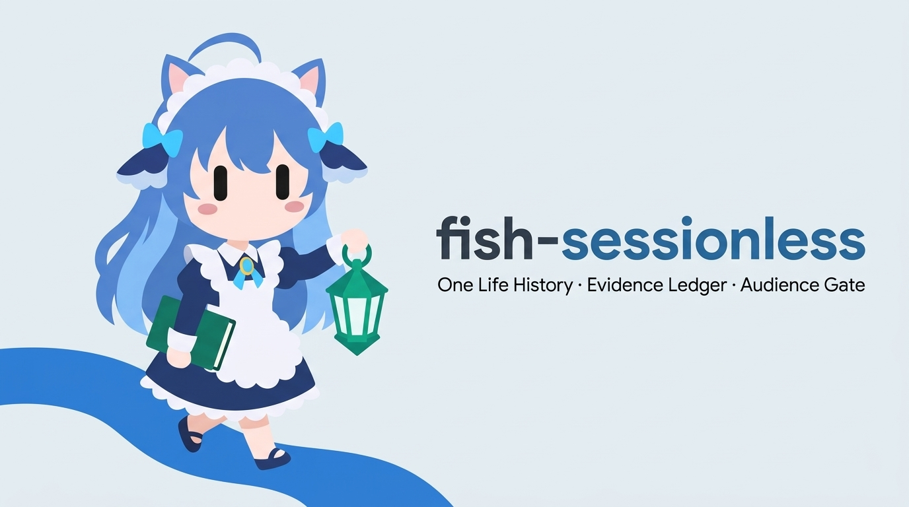
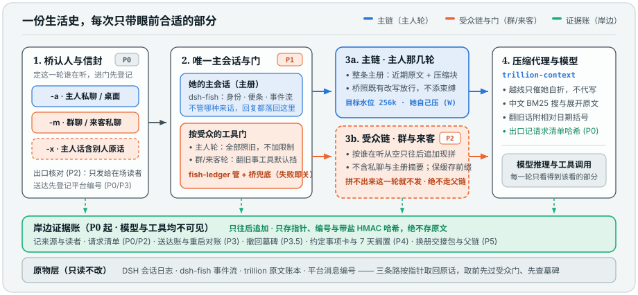

<div align="center">

<sub>横幅立绘基于「大肥鱼」原始人设生成，随仓库以 MIT 授权。</sub>

<br>

**简体中文** ｜ <a href="./README_en.md">English</a>

<br>

<div>
<a href="https://github.com/mochi-fish/fish-sessionless/actions/workflows/ci.yml"></a>
<a href="./LICENSE"></a>
<a href="https://nodejs.org/"></a>
<a href="https://github.com/deepseek-ai/deepseek-harness"></a>
<a href="https://baka.studio/p/sessionless-architecture/"></a>
</div>

<br>

<a href="https://baka.studio/p/sessionless-architecture/">最初完整设计稿</a> ｜
<a href="docs/zh/README.md">中文文档（正本）</a> ｜
<a href="docs/architecture/index.html">仓内架构图页</a> ｜
<a href="docs/adr/README.md">ADR 决策记录</a> ｜
<a href="packages/README.md">子包说明</a> ｜
<a href="SECURITY.md">安全报告</a>

</div>

---

**`fish-sessionless`** 是为长期陪伴型 Agent 设计的一套**「无会话分割（Sessionless）」架构**——**一份生活史，每次只带眼前合适的部分**。所有接线都做在 DSH（基于 DeepSeek Harness）的插件口子上，不改宿主源码。陪伴体缺省叫「大肥鱼」，沿用自上游成长插件 **[`mochi-fish/dsh-fish`](https://github.com/mochi-fish/dsh-fish)**。

📐 **[阅读最初完整设计稿与交互式架构图（baka.studio）](https://baka.studio/p/sessionless-architecture/)** —— 包含可按来话类型切换的交互式河道总览图、主链与受众链对比、四层记忆与原话回溯、改约事项卡、换册父链以及二十余个开源项目的洁净室取舍详录。

> [!NOTE]
> **状态：早期阶段，自用为主。** 接口、文件格式与目录都还会变，没有版本承诺。当前公开的是**第一批（Batch 1）**不碰线上单文件桥的独立组件、规范文档、隐私扫描与合成评测架子；负责认人、路由与请求改写的模块化桥排在第二批公开。

<p align="center">
  
</p>

## 🎯 要解决的四个矛盾与三条底线

一个陪伴体只有一条连续的生活时间线，却要同时面对**主人的私聊、热闹的群聊、来私聊的客人**：

- **上下文串话** —— 群里被叫到的那一轮，模型拿到的请求里如果原样躺着主人私聊的旧话，私密信息全靠模型「嘴严」硬扛。
- **工具越界翻旧账** —— 她在群聊或来客轮一调回忆、搜索或文件工具，就能翻出不该给这一轮在场读者看的旧事。
- **摘要被写歪、过时待办反复抄** —— 代码向的旧压缩规则不留人、承诺与日期；旁路模型代写摘要会抹掉她的口吻，而早就取消的旧待办又会被摘要反复抄写几十次。
- **生活史越攒越重** —— 几个月下来单会话动辄数十万乃至上百万 Token，每次请求越来越贵，换模型时还可能撞上窗口上限、图片上限或思考块漂移。

因此整套设计立下**三条不变的底线**：

1. **她只有一份生活史** —— 不按房间把她拆成几个人；不管走主链还是受众链，她的回复最终都落回同一份主日志。
2. **主人那几轮照旧** —— 主人私聊、桌面打字与她自己醒来的轮次走**主链**，带整本主册，不给日常相处加额外束缚。
3. **群和来客那几轮，出错一律按「不给」（Fail-Closed）** —— 读者算不出、配置读不到、门没留判定，一律按最严拦截；受众链拼不出来，这一轮就不发。

## 🧱 核心机制设计

### 1. 主链与受众链：各走各的路，落回同一本日志
| 维度 | 主链（主人轮 / 桌面 / 自醒） | 受众链（群聊轮 / 来客私聊轮，`P2`） |
|---|---|---|
| **谁走这条** | 主人的私聊、桌面打字、她自己醒来与夜间整理 | 每个群、每位来客各自一条独立的受众链 |
| **里面装什么** | 整条主册：近期原文 + 她自己压的折叠块 | 只装这个群或这位来客能看的近期原话与受众版摘要；**不含任何私聊及她在主册看到私聊时写的摘要/便条** |
| **怎么维持缓存** | 照既有规则放行 | 从空开始**只往后追加组装**，绝不在同一份请求上临时删消息（删一次缓存前缀就整段失效） |
| **回复落在哪** | **同一份 DSH 主日志** | **同一份 DSH 主日志**（换册后绝不走父链回翻主册） |

### 2. 四层记忆结构：「折掉的不等于丢掉」
她眼前的请求只是最上面薄薄一层，往下依次由三层托底：
1. **眼前的请求层**：按「这一轮谁在听」组装出的当轮上下文，受水位（如 256k）约束。
2. **派生物层**：她自己压的折叠块、事项卡（`P4`）、换册交接包（`P5`）、便条与自述。派生物的读者取所有来源读者的**交集**；她亲手写下的内容按写时她能看到的最严范围算。
3. **岸边证据账（`P0` 起）**：置于模型与她的工具都碰不到的目录，只往后追加 JSONL，**只存指针、消息编号与带盐 HMAC 哈希，绝不存原文**。桥、宿主插件 `fish-ledger` 与压缩代理三方各写各的文件、互相核对。
4. **只读原物层**：DSH 会话日志、`dsh-fish` 事件流、`trillion-context` 原文账本与聊天平台消息编号——**永远不改、不复制**。沿三条路（DSH 日志、压缩代理 `search_context` + `decompress`、事件流）随时可按指针取回逐字原话，取之前一律先过受众门、先查撤回墓碑。

### 3. 渐进演进的分阶段层（`P0` – `P6` · `W` · `G2`）
每一层均可独立上线、独立验证、独立成对回退，随时可以停在任意一层：

- **`P0` 只记账** → 入口信封登记、证据账与压缩代理出口请求哈希对账，她看到的一字不变。
- **`P0.5` `heard` 失败即关** → 主人的话洗净记入事件流前先只数不写，必须等 `P1` 门真挡生效后才允许落盘。
- **`P1` 按受众的工具门** → 群与来客轮默认挡住能翻旧事的工具，由 `fish-ledger` 主判、桥同表兜底，先 `audit` 观察零误挡再切 `enforce` 真挡。
- **`W` 降水位与自写折叠** → 按会话设水位上限（如 256k），越线只用中文规则包催她自己整理折叠，绝不让旁路模型代写。
- **`G2` 原话召回与多模型** → 中文单双字 BM25 + `around` 前后文展开、翻旧话内联附注相对公历日期、多模型输入判窗与切换缓截护栏。
- **`P2` 按受众拼请求** → 群与来客脱离主链，各走只装自身可见材料的受众链，桥出口二次核对收件人。
- **`P3` / `P3.5` 送达账与撤回墓碑** → 发话临界落盘平台消息号，断线重启先对账（查不清照实记「不知道到没到」，绝不盲目重发）；撤回消息记入备份外单调墓碑账本，恢复旧备份前先取并集遮盖。
- **`P4` 改约事项卡与淡忘** → 不让模型猜状态，只按明确句式将约定记为已推迟 / 已取消 / 被替代 / 转述待确认等状态；7 天无人提起自动转入「搁着」退出提醒但不删记录。
- **`P5` / `P6` 换册交接与外部记忆过滤** → 日子太长时由她先落笔，从证据账生成交接包翻入新册，主链可沿父链回查旧册（旧册永久只读）；外部记忆库待受众过滤完备后可选接入。

## 📦 当前仓库内容与开源批次

单独安装第一批组件尚不能拼成可直接聊天的完整系统（认人、送消息与请求改写位于 `bridge/`，第二批公开）。**第一批可直接独立使用的包括：共用身份配置包、中文压缩规则包、多视图隐私扫描器、两套合成评测架子、运行守卫与 OneBot 录制器。**

| 路径 | 状态 | 说明 |
|---|---|---|
| [`docs/`](docs/zh/README.md) | ✅ 已就绪 | 中文正本（7 篇机制文档）、[英文摘要](docs/en/README.md)、[8 篇 ADR 决策记录](docs/adr/README.md)、[仓内静态架构图页](docs/architecture/index.html) |
| [`packages/config`](packages/config/) | ✅ 已就绪 | `v0.1.0` 共用身份配置：主人各渠道账号与称呼、陪伴体名、主动开口白名单、主会话识别与账本根；缺省或核验失败一律按「没有主人」从严处理 |
| [`packages/fish-pack-zh`](packages/fish-pack-zh/) | ✅ 已就绪 | `v0.2.0` 压缩代理中文规则包：越线催压提示词，以及压缩、检索、展开三工具的中文说明与 SHA-256 清单 |
| [`tools/privacy-scan`](tools/privacy-scan/) | ✅ 已就绪 | 发布前隐私与指纹扫描器：支持工作树 / Git 历史多视图扫描、路径用户名与私网地址拦截、虚构号白名单校验与本机私有指纹库挂接 |
| [`tools/`](tools/README.md) | ✅ 已就绪 | 工程与上线守卫：`model-switch-check`（切模型窗口与图片上限门禁）、`proxy-ready`、`netguard`、`offline-guard`、`run-exclusive`、`scratch-guard` |
| [`evals/open-book-eval`](evals/open-book-eval/) | ✅ 已就绪 | 合成世界开卷记忆评测与多协议转发沙盒（Anthropic / OpenAI / Gemini / DeepSeek），带盲测锁与出站隐私门 |
| [`evals/recall-eval`](evals/recall-eval/) | ✅ 已就绪 | 基于合成事件流与合成日记的回忆命中评测尺子 |
| [`recorder/`](recorder/README.md) | ✅ 已就绪 | OneBot 全量原始帧与媒体归档录制器（独立第二 WebSocket 客户端，媒体按 SHA-256 去重，不含任何第三方协议定义） |
| [`bridge/_slice/`](bridge/_slice/MANIFEST.md) | 🔨 切片基建 | 单文件桥切片清单与逐字节拼回构建器，用于第二批模块化拆桥前的等价性证明 |
| `packages/{ledger-core, audience, fish-ledger}` | 🚧 整理合入中 | 纯 Node 内置模块证据账核心、纯函数受众与工具门判定、DSH 记账把门插件（完成中性化键名迁移后合入，详见 [`packages/README.md`](packages/README.md)） |

### 分批公开计划

| 批次 | 公开内容 |
|---|---|
| **第一批（当前）** | 设计文档、ADR 与架构图页；`packages/config`、`packages/fish-pack-zh`；`tools/privacy-scan` 与运行守卫；两套合成评测架子；OneBot 录制器；（及中性化后的 `ledger-core` / `audience` / `fish-ledger`） |
| **第二批** | 模块化拆分并证明逐字节等价后的 `bridge/`（个人值全部进配置，保留单文件构建产物）、教学审批面板、`golden-request` 请求对照工具、上游锚点表、小插件与第三方补丁 `patches/` |
| **第三批** | 陪伴向上下文管理代理完整线（[`mochi-fish/trillion-context`](https://github.com/mochi-fish/trillion-context)）与中文规则包 `0.3.x`、上线编排库与假家目录演练架子（`ops/`）、可选扩展模块（教学审批、留言板、帮手挡板、回复器、QQ 空间写等，统一缺省关闭） |

## 🚀 快速开始与测试

要求 **Node.js 22+**。核心包仅使用 Node.js 内置模块，测试直接由内置 `node --test` 执行：

```bash
git clone https://github.com/mochi-fish/fish-sessionless.git
cd fish-sessionless

# 1. 共用身份配置包单元测试
node --test "packages/config/test/*.test.mjs"

# 2. 中文压缩规则包校验测试
node packages/fish-pack-zh/test/test-pack.mjs

# 3. 隐私扫描器多视图与自检测试套件
node --test "tools/privacy-scan/test/*.test.mjs"

# 4. 网络/离线/临时目录守卫与多模型切换门禁测试
node tools/test/run-all.mjs

# 5. OneBot 录制器模拟服务端测试
node recorder/test/test-recorder.mjs
```

所有测试仅使用虚构账号（`tools/privacy-scan/fake-ids.json`）与合成句子；若检测到目标路径位于真实运行目录（`~/.dsh`、`~/.dsh-fish`、`~/.dsh-fish-ledger`）下将直接拒绝执行。

## 📚 文档与 ADR 导航

中文文档为正本，推荐从 **[概览](docs/zh/overview.md)** 与 **[最初交互式设计稿](https://baka.studio/p/sessionless-architecture/)** 读起：

| 核心机制文档（`docs/zh/`） | 架构决定记录（`docs/adr/`） |
|---|---|
| • **[概览](docs/zh/overview.md)**：要解决什么、整体怎么搭、一轮怎么走、分几步做<br>• **[证据账](docs/zh/evidence-ledger.md)**：只追加的账记什么、不记什么、谁来写、怎么对账<br>• **[受众和工具的门](docs/zh/audience-gate.md)**：这一轮谁在听、哪些工具挡、门坏了怎么办<br>• **[水位](docs/zh/water-level.md)**：每次请求带多少历史、为什么绝不让别的模型代写<br>• **[记忆和原话](docs/zh/memory.md)**：四种遗忘成因、原物层回溯、约定淡忘与换册<br>• **[部署前提](docs/zh/deployment.md)**：DSH 版本、依赖插件与第一批可单独使用的部分<br>• **[已知局限](docs/zh/known-limitations.md)**：当前做不到或有代价的地方及缓解措施 | • **[ADR-0001](docs/adr/0001-one-session-for-life.md)**：终身只住一条会话<br>• **[ADR-0002](docs/adr/0002-evidence-ledger-outside-model-view.md)**：证据账放在模型视野之外<br>• **[ADR-0003](docs/adr/0003-fail-closed-audience-gate.md)**：失败即关的受众工具门<br>• **[ADR-0004](docs/adr/0004-config-driven-identity.md)**：身份由单一配置驱动<br>• **[ADR-0005](docs/adr/0005-frozen-request-time-labels.md)**：冻结请求期现贴标签防缓存失效<br>• **[ADR-0006](docs/adr/0006-mem-tools-every-turn.md)**：外部记忆工具在各轮的门控取舍<br>• **[ADR-0007](docs/adr/0007-heard-writes-fail-closed.md)**：`heard` 写入失败即关<br>• **[ADR-0008](docs/adr/0008-water-level-via-forked-proxy.md)**：通过压缩代理分支控制水位 |

## 🤝 参与贡献与安全披露

- 参与贡献前请阅读 **[CONTRIBUTING.md](CONTRIBUTING.md)**。
- 安全与受众边界漏洞请按 **[SECURITY.md](SECURITY.md)** 通过 GitHub **Report a vulnerability** 私下报告，不要开公开 Issue。
- 录制器与桥接组件在本地会留存聊天消息，启用前请遵守平台规范并取得相关成员同意。

## ⚖️ 许可与致谢

全仓（代码、文档与自制配图）采用 **[MIT License](LICENSE)** 开源。

本项目使用了 **[billion-context](https://github.com/ranxianglei/billion-context)**（含其内核 **[acp-kernel](https://github.com/ranxianglei/acp-kernel)** 的部分代码）：中文规则包改写自其提示词，评测架子包含一份从其内核源码打包的消息转换函数，按其许可里的署名条款在此标明。架构设计过程中亦调研参考了万卷、`dsh-live-compact`、Comma、Cortico、DeepSeekBot 等项目的公开机制思路由洁净室独立实现；完整第三方许可原文与致谢见 **[THIRD-PARTY-NOTICES](THIRD-PARTY-NOTICES)**。

本项目与 DeepSeek、DSH 官方没有关系。

## ⭐ Star History

<div align="center">

[](https://star-history.com/#mochi-fish/fish-sessionless&Date)

</div>

<div align="center">

_不按房间把她拆成几个人；只有一条生活时间线，每次只带眼前合适的部分。_

<br>

<a href="https://github.com/mochi-fish">
  
</a>

</div>
