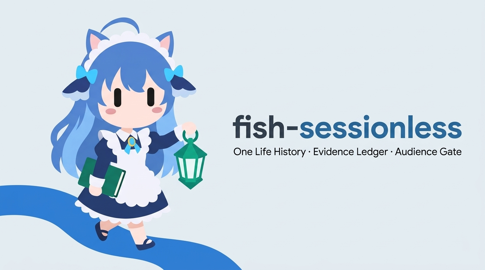
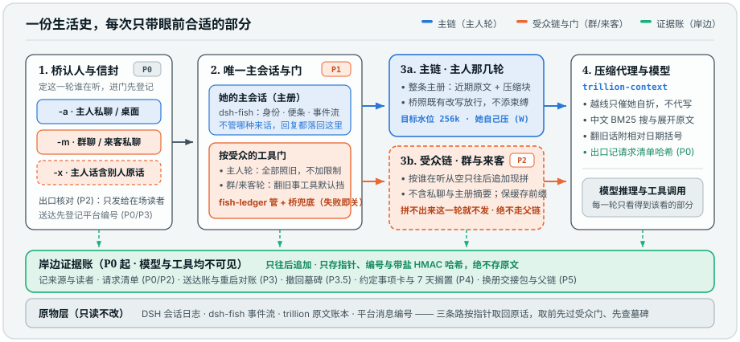

<div align="center">

<sub>Banner artwork generated from the original "Big Fat Fish" character design and released under MIT.</sub>

<br>

<a href="./README.md">简体中文</a> ｜ **English**

<br>

<div>
<a href="https://github.com/mochi-fish/fish-sessionless/actions/workflows/ci.yml"></a>
<a href="./LICENSE"></a>
<a href="https://nodejs.org/"></a>
<a href="https://github.com/deepseek-ai/deepseek-harness"></a>
<a href="https://baka.studio/p/sessionless-architecture/"></a>
</div>

<br>

<a href="https://baka.studio/p/sessionless-architecture/">Original Interactive Spec</a> ｜
<a href="docs/en/README.md">English Summary</a> ｜
<a href="docs/zh/README.md">Chinese Docs (Canonical)</a> ｜
<a href="docs/architecture/index.html">Visual Architecture Page</a> ｜
<a href="docs/adr/README.md">ADRs</a> ｜
<a href="SECURITY.md">Security</a>

</div>

---

**`fish-sessionless`** is a **"sessionless" architecture** for long-lived companion agents — ***one life history, carrying only what fits the audience in front of her***. Every integration sits strictly on the plugin hooks of **DSH** (built on DeepSeek Harness) without patching the host. By default, the companion is named "大肥鱼" (*Big Fat Fish*), inherited from **[`mochi-fish/dsh-fish`](https://github.com/mochi-fish/dsh-fish)**.

📐 **[Read the Original Interactive Design Specification (baka.studio)](https://baka.studio/p/sessionless-architecture/)** — Features interactive per-audience flow diagrams, Main Chain vs. Audience Chains, the four-layer memory stack, commitment item cards, epoch volume handoff, and clean-room design notes across 20+ surveyed repositories.

> [!NOTE]
> **Status: Early stage, built primarily for our own live deployment.** Interfaces, schemas, and directories are still evolving without semver commitments. Today's repository ships **Batch 1** — standalone config & rule packages, canonical specs, privacy scanners, and synthetic-world evaluation harnesses. The modularized routing bridge lands in Batch 2. Chinese documentation ([`docs/zh/`](docs/zh/README.md)) is canonical.

<p align="center">
  
</p>

## 🎯 Four Structural Tensions & Three Iron Rules

When a companion lives along **one continuous life timeline** while interacting with **her owner in private DMs, group-chat members, and visiting guests**, four problems appear immediately:

- **Cross-Audience Context Bleed** — Without per-audience assembly, group-chat requests carry raw private DM history straight into the model context.
- **Unbounded Tool Reach** — Calling search, recall, or file tools during a group or guest turn can surface private conversations meant only for the owner.
- **Distorted Summaries & Zombie To-Dos** — Coding-style compression prompts drop people, promises, and dates; auxiliary-model ghostwriting erases her voice, while canceled plans get copied across summaries dozens of times.
- **Unbounded Timeline Growth** — Months of history swell per-request token cost and risk hitting image/window walls or thinking-block drift when switching models.

Every mechanism in `fish-sessionless` upholds **three non-negotiable rules**:

1. **One Life History** — Never split her into disconnected per-room bots; whether a turn runs on the Main Chain or an Audience Chain, every reply lands back into the same main log.
2. **Owner Turns Stay Unrestricted** — Owner DMs, desktop chats, and self-wake turns run on the **Main Chain** with the full main volume and zero extra friction.
3. **Group & Guest Turns Fail Closed** — Unresolved audience, missing config, or gate errors always evaluate to **deny**; if an Audience Chain cannot be assembled cleanly, the turn is held rather than leaked.

## 🧱 Core Architecture

### 1. Main Chain vs. Audience Chains
| Dimension | Main Chain (Owner / Desktop / Self-Wake) | Audience Chains (Group / Guest Turns, `P2`) |
|---|---|---|
| **Contents** | Full main volume: recent verbatim turns + her self-written fold blocks | Only recent turns and approved summaries visible to that specific group or guest; **excludes private DMs and any summary/note written while she could see private DMs** |
| **Cache Discipline** | Standard request rewrites | **Forward-only assembly from empty** per audience — never mutates or deletes messages mid-prefix (preserving 90%+ prompt-cache hits) |
| **Where Replies Land** | **The single DSH main log** | **The single DSH main log** (and never traverses parent-volume links) |

### 2. Four-Layer Memory Stack: *"Folded Never Means Deleted"*
1. **Active Request View**: Thin per-turn slice assembled for the current audience within the token water level (e.g., 256k).
2. **Derived Layer**: Her self-written fold blocks, commitment item cards (`P4`), volume handoff packs (`P5`), and notes — permitted audience equals the **intersection** of source audiences (or her visibility ceiling at write time).
3. **Out-of-Band Evidence Ledger (`P0+`)**: Append-only JSONL outside model and tool reach storing **only pointers, message IDs, and salted HMAC hashes — zero raw text**, independently cross-checked across bridge, `fish-ledger`, and proxy.
4. **Read-Only Raw Source Layer**: DSH session logs, `dsh-fish` event streams, `trillion-context` raw store, and platform message IDs — immutable and recoverable via three gated paths after audience-gate and tombstone checks.

### 3. Phased Rollout Layers (`P0` – `P6` · `W` · `G2`)
Each layer ships, verifies, and rolls back independently:
- **`P0` Evidence Ledger** → Envelope tagging (`-a / -m / -x`) & outbound manifest hash reconciliation with zero visible change to her.
- **`P0.5` Fail-Closed `heard`** → Dry-run counting first; writes owner utterances into her event stream only when `P1` enforce mode is active.
- **`P1` Audience Tool Gate** → Blocks memory-reaching tools on group/guest turns (`fish-ledger` primary + bridge fallback; audited for zero owner false-positives before switching `audit → enforce`).
- **`W` Water Level & Self-Folding** → Per-session water level (256k), Chinese nudges, real-usage truncate gate, and host-image folding — strictly self-written (`noGhostwrite`).
- **`G2` Verbatim Recall & Multi-Model** → CJK unigram+bigram BM25 + `around` expansion, execution-time relative-date notes, per-model input windows, and post-switch truncation hold.
- **`P2` Per-Audience Request Assembly** → Dedicated forward-only Audience Chains and outbound recipient verification.
- **`P3` / `P3.5` Delivery Ledger & Tombstones** → Pre-send `in-flight` platform ID logging (uncertain sends recorded honestly as unknown, never blindly resent) and monotonic backup-external withdrawal tombstones.
- **`P4` / `P5` / `P6` Commitment Cards, Volume Handoff & Optional Mem Filtering** → Rule-extracted promise states with 7-day shelving, read-only volume rollover with parent-chain lookup, and audience-filtered external memory.

## 📦 Repository Contents & Release Batches

| Path | Status | Description |
|---|---|---|
| [`docs/`](docs/en/README.md) | ✅ Available | [English summary](docs/en/README.md), [7 canonical Chinese docs](docs/zh/README.md), [8 ADRs](docs/adr/README.md), and static [Visual Architecture Page](docs/architecture/index.html) |
| [`packages/config`](packages/config/) | ✅ Available | `v0.1.0` Shared identity config loader (owner IDs, forms of address, companion name, main session matcher, ledger root); fails closed to "no owner" |
| [`packages/fish-pack-zh`](packages/fish-pack-zh/) | ✅ Available | `v0.2.0` Chinese compression rule pack (water-level nudges and three compression tool prompts with SHA-256 manifest) |
| [`tools/privacy-scan`](tools/privacy-scan/) | ✅ Available | Multi-view working-tree & Git-history privacy/fingerprint scanner |
| [`tools/`](tools/README.md) | ✅ Available | Operational guards: `model-switch-check`, `proxy-ready`, `netguard`, `offline-guard`, `run-exclusive`, `scratch-guard` |
| [`evals/open-book-eval`](evals/open-book-eval/) | ✅ Available | Synthetic-world open-book memory eval & multi-protocol forwarder sandbox with blind locks and egress privacy gates |
| [`evals/recall-eval`](evals/recall-eval/) | ✅ Available | Synthetic event-stream & diary recall benchmark ruler |
| [`recorder/`](recorder/README.md) | ✅ Available | Standalone OneBot raw-frame & SHA-256 media archive recorder (zero third-party proto files) |
| [`bridge/_slice/`](bridge/_slice/MANIFEST.md) | 🔨 Tooling | Byte-identical slice manifest & reassembly builder preparing for Batch 2 modular `bridge/` |
| `packages/{ledger-core, audience, fish-ledger}` | 🚧 Incoming | Zero-dependency ledger core, pure-function audience gate, and DSH plugin (landing after owner-neutral key cleanup; see [`packages/README.md`](packages/README.md)) |

## 🚀 Quick Start & Verification

Requires **Node.js 22+** (`node --test`, zero external test-runner dependencies):

```bash
git clone https://github.com/mochi-fish/fish-sessionless.git
cd fish-sessionless

node --test "packages/config/test/*.test.mjs"
node packages/fish-pack-zh/test/test-pack.mjs
node --test "tools/privacy-scan/test/*.test.mjs"
node tools/test/run-all.mjs
node recorder/test/test-recorder.mjs
```

## 🤝 Contributing, Security & License

- See **[CONTRIBUTING.md](CONTRIBUTING.md)** and report security issues privately via **[SECURITY.md](SECURITY.md)** (GitHub Security Advisories).
- **[MIT License](LICENSE)** across all code, docs, and original assets.
- Uses **[billion-context](https://github.com/ranxianglei/billion-context)** (including parts of **[acp-kernel](https://github.com/ranxianglei/acp-kernel)**), attributed per its license terms; full notices in **[THIRD-PARTY-NOTICES](THIRD-PARTY-NOTICES)**. Unaffiliated with DeepSeek or DSH.

<br>

<div align="center">

_One life history, carrying only what fits the audience in front of her._

<br>

<a href="https://github.com/mochi-fish">
  
</a>

</div>
